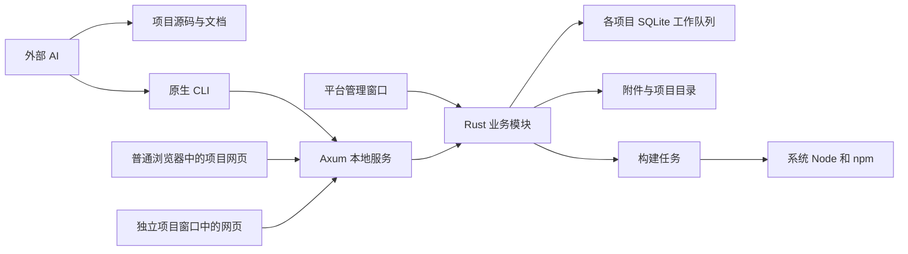

# 本地服务与 AI 工具接口

状态：v0.14，本地服务及配套接口已确认；M1 至 M3 已有内部验证，M4 生命周期与迁移 CLI/API 已验证，GUI 全流程未完成，完整首版仍待后续阶段  
更新日期：2026-10-16

本文细化[平台开发约定](platform-development-contract.md)中的运行服务、数据库访问、浏览器连接和外部 AI 工具。已确认的基础为 Tauri 2 + Rust + SQLite；Node 使用系统安装版本，最低 22.12.0，推荐 24 LTS。

以下方案已确认，作为第一版实现依据。当前开发接口包括 M1 项目、SQL、会话与附件、M2 SDK、模板、构建与任务、M3 备份维护，以及 M4 项目导入导出、复制、回收站和工作区迁移；实际命令见[开发说明](development.md)，M4 包、真实迁移结果与 GUI 验证边界见 [M4 记录](m4-verification.md)。完整空间、基本信息与发行仍待后续阶段，不能按整份契约理解为已经上线。`platform` 是正式命令名称占位符；开发 CLI 为 `local-projects-dev`。示例中的项目 ID、端口和路径为说明性取值。项目目录、SDK 方法和数据类型沿用主文档；仍需补齐的字段、管理入口及验证见[技术决策与实施清单](remaining-technical-decisions.md)。

## 1 已确认方案

| 部分 | 确定选择 | 用途 |
| --- | --- | --- |
| HTTP 服务 | Axum + Tokio | 提供网页、JSON 接口和事件通知 |
| 静态资源 | Axum 受控文件响应 | 提供当前入口及不可变构建代资源，遵守身份、路径、CSP 和缓存规则 |
| 服务进程 | Tauri 主进程内的 Rust 服务 | 软件启动即运行，关闭管理窗口后保留项目窗口、托盘和服务 |
| 桌面承载 | 管理窗口 + 独立项目 WebView 窗口 | 同项目重复打开只聚焦复用；项目没有原生管理权限 |
| 数据库驱动 | rusqlite，启用 bundled SQLite | 固定数据库引擎，不依赖用户安装 SQLite |
| 数据库执行 | 每个活跃项目一个数据库工作线程和串行队列 | 同项目事务清晰，不阻塞 UI 或 HTTP 执行线程 |
| 请求协议 | HTTP JSON | SDK 和 AI 工具调用同一组业务能力 |
| 数据变化通知 | SSE | 告诉网页重新查询，或提示有新网页产物 |
| AI 入口 | 随安装包分发的原生 Rust CLI | 无 Node 时也能查询项目、操作数据库和检查状态 |
| MCP | 第一版后置 | 后续作为同一组能力的另一入口 |

Axum 直接与 Tokio 配合，并可复用 tower 生态；它提供现成的 SSE 响应支持，参见 [Axum](https://docs.rs/axum/latest/axum/) 和 [SSE 文档](https://docs.rs/axum/latest/axum/response/sse/)。这里需要的是一套本地 HTTP 服务，不需要为每个项目启动 Web 后端。

rusqlite 的 bundled 功能将 SQLite 编译并链接到平台中，因此用户无需额外安装数据库程序，参见 [rusqlite 官方说明](https://github.com/rusqlite/rusqlite)。这是软件自带的数据库引擎，与使用系统 Node 的决定分别管理。



平台首页可以通过 Tauri 原生命令访问同一组 Rust 业务模块。AI 生成的项目网页只使用浏览器 SDK 和 HTTP，不获得平台首页的原生管理接口。HTTP、原生命令和 CLI 不分别实现三套数据规则。

## 2 进程与生命周期

第一版每个操作系统用户运行一个平台主实例，一次管理一个工作区。多个项目共享服务；不为每个项目启动独立 Web 后端或 Node 服务，也不安装开机守护服务。系统 WebView 自身可以使用渲染进程，不把共享后端描述成整个软件只能有一个操作系统进程。

启动顺序：

1. 确认单实例，读取固定位置的迁移日志和当前工作区设置，核对已提交位置，再校验目录。
2. 初始化 Rust 业务模块；数据库按项目需要打开，不一次打开所有历史项目。
3. 绑定本地端口，生成本次运行的实例 ID 和管理凭据。
4. 服务就绪后写入发现文件，再开放项目入口和 AI 工具调用。

重复打开桌面程序时，将请求转给当前实例，不再启动第二套服务。可采用 [Tauri single-instance 插件](https://v2.tauri.app/plugin/single-instance/)，并对工作区建立运行期占用标识，避免另一个平台实例误管同一目录。该标识不阻止用户授权的外部 SQLite 工具正常访问数据库。

关闭项目窗口只释放该页面及设备，不停止项目数据库服务；关闭管理窗口保留其他项目窗口、托盘和服务。即使所有窗口关闭也不等于退出；可通过托盘、Dock 或再次启动恢复管理窗口。普通浏览器标签不随桌面窗口关闭。

明确退出时先停止接收新任务及新的业务操作；构建可安全取消并记为 `interrupted`，备份等任务在安全结束点停止。恢复、导入登记、删除及迁移等目录切换须完成可恢复的安全阶段并持久记录，不能强杀正在提交的操作。排空数据库、上传及文件读取，清理事务、关闭全部桌面项目窗口和服务，最后删除属于本实例的发现文件。准备覆盖更新时等待活动任务结束，再沿用该退出流程；持久维护不自动解除。工作区迁移沿用其全局冻结和安全重建流程。

构建子进程由平台管理，不允许构建请求主动脱离管理变成常驻项目后端。异常退出后，下一次启动检查遗留任务并标记中断，不自动把残留临时产物当作成功产物加载。

### 2.1 窗口创建、复用与导航

管理窗口展示平台页面；项目以顶层本地网页加载在独立 `WebviewWindow`。宿主按项目 ID 串行管理创建与复用，防止同时点击产生重复窗口。同项目已有窗口时只恢复可见并聚焦，不自动刷新；多个项目可同时打开，普通浏览器可保留多个标签。

首次打开通过 launch ticket 建立项目会话。旧会话或旧代次窗口仍显示维护、重连或重载提示；重复打开只复用容器，不能静默更新旧文档代次、重放写入或越过回收站与维护限制。用户明确重新加载时取得有效入口。未保存内容处理由项目协作，首版不承诺自动识别任意表单，也不自动恢复全部项目窗口。

管理窗口和项目窗口使用独立标签；Tauri capabilities、插件及自定义命令均落实宿主权限校验，项目和它打开的新页面不授予管理原生命令。项目不需要 Tauri IPC。宿主处理顶层导航及 `target=_blank`／`window.open`，外部 HTTP(S) 链接由明确用户动作交给系统浏览器，禁止任意原生协议跳转；项目窗口仅允许本项目和平台会话连接流程所需页面。普通浏览器不承载平台管理 UI。完整体验与设备释放规则见主约定第 2.1 节。

## 3 SQLite 访问方案

### 3.1 连接和并发

使用 rusqlite 的同步接口，但放在专用数据库工作线程执行。HTTP 处理器把任务送入对应项目队列，异步等待结果；不直接在 Tauri UI 线程或 Tokio 异步执行线程中执行阻塞 SQL。

每个活跃项目第一版使用一个连接，同项目查询和写入按队列执行，不同项目可以并行。事务作为完整任务进入队列，不能与其他请求交叉执行。空闲项目可以关闭连接和工作线程，之后按需恢复；关闭前必须确认没有未完成任务。

暂不引入 ORM、每项目连接池或应用专属服务。AI 可以定义任意业务表、索引和查询，平台负责连接、事务、结果编码及错误处理。

### 3.2 数据库配置

| 配置 | 第一版默认值 |
| --- | --- |
| 日志模式 | WAL |
| 外键约束 | 平台连接设置 `foreign_keys=ON` |
| 同步策略 | `synchronous=FULL` |
| 忙等待 | `busy_timeout=5000`，单位毫秒 |
| 文件位置 | 本机磁盘上的项目 `data/` 目录 |

WAL 允许外部读连接与写连接协调工作，但不意味着有多个同时提交的写者。共享网络文件系统不属于第一版支持范围，参见 [SQLite WAL 说明](https://www.sqlite.org/wal.html)。平台编译时锁定已包含相关 WAL 修复的受维护 SQLite 版本，并在环境诊断中报告实际 `sqlite_version()`；具体驱动和数据库补丁版本在实现时锁定。

AI 直接用外部 SQLite 工具连接时，自行遵守外键约束和兼容的引擎配置。优先使用平台 SQL 工具可以复用已验证的引擎，并自动触发页面刷新。平台不把 SQLite 文件当普通二进制文件修改。

平台 SQL 接口的调用方不能改变所管理连接的外键、日志、同步、忙等待等配置，不能自行控制事务或附加其他数据库；业务查询、写入和建表改表仍开放。接口应拒绝违反这些不变量的请求，而非让一次调用影响后续请求。外部维护完成后，平台接管连接时重新核对配置；不能满足时返回诊断，不悄悄按降级设置运行。

### 3.3 事务、取消和失败

`execute` 处理一条 SQL，包括查询、DML、DDL 和适用的维护语句。`transaction` 一次提交有序语句列表，在同一连接内整体提交或回滚；不支持跨 HTTP 请求持有事务。

SQL 返回成功前，必须确认提交完成。发生错误后清理事务，才可执行队列中的后续任务。请求超时或浏览器断线只说明调用方停止等待，不等于数据库操作已经取消；需要取消时，必须确认数据库操作停止并完成事务清理。

客户端不得因超时或断线自动重放 SQL 写入，原请求可能已经提交。请求 ID 用于日志关联，不自动等于幂等键；第一版不承诺跨重启的写入去重。调用方遇到不确定结果时先查询状态或数据，再决定下一步。

## 4 本地服务发现

服务仅监听 `127.0.0.1`。优先复用上次成功使用的端口；端口被占用时让操作系统分配可用端口，不停止占用端口的其他程序。只有绑定和初始化成功后，才发布本次服务地址。

固定发现位置为平台的用户应用数据目录：

```text
appLocalDataDir/
└── runtime/
    ├── connection.json      服务地址、实例和当前工作区信息
    └── control-token        本次实例的管理凭据
```

这两个文件不在可移植项目中，不进入项目备份或导出。仅允许当前操作系统用户读取管理凭据。平台重启时更新实例 ID 和凭据；通过完整文件替换发布状态，避免 CLI 读到半份 JSON。

发现文件示例：

```json
{
  "apiVersion": 1,
  "instanceId": "rt_example",
  "pid": 12345,
  "baseUrl": "http://127.0.0.1:43120",
  "workspaceRoot": "[当前工作区绝对路径]"
}
```

CLI 使用平台固定应用标识解析该位置，读取后检查地址确实为本机地址，并通过健康检查核对实例 ID 和接口版本，再进行带管理凭据的握手。不能只相信 PID、文件存在或端口可连接。残留文件不代表服务仍在运行。

端口改变后，旧浏览器标签不能自动发现另一个端口上的服务，用户或 AI 应重新获取入口。项目源码、数据库和 README 不保存固定端口。

## 5 浏览器会话和访问入口

管理工具与项目网页使用不同的访问身份：

| 入口 | 身份与范围 |
| --- | --- |
| 原生 CLI | 本次实例的 Bearer 管理凭据，可以管理工作区内的各项目 |
| 项目网页 | 绑定项目的浏览器会话，调用当前项目 SDK 接口 |
| 平台首页 | 由宿主原生命令调用受控的管理能力，不向项目页面分发管理凭据 |

桌面新建项目窗口（或明确重连）和 CLI 获取浏览器入口都采用同一流程；仅聚焦已有有效窗口不重复执行：

1. 平台创建短期、单次使用的 launch ticket，绑定当前实例和项目，默认有效期 60 秒。
2. 返回平台连接页地址，将 ticket 放在 URL fragment 中。连接页负责兑换，不由项目源码处理管理登录。
3. 连接页通过 POST 兑换项目会话，移除地址中的 ticket，再转到干净的项目 URL。
4. 会话使用 `HttpOnly`、`SameSite=Strict` 的 Cookie，限定到对应项目路径；项目 API、附件访问和 SSE 使用该会话。

连接页不加载第三方资源，也不记录 ticket。长期管理凭据永不写入 URL、项目清单、SDK 构建产物或普通日志。ticket 过期、已使用或平台重启后，重新获取入口即可。

桌面 WebView 与普通浏览器分别建立会话，不共享 Cookie 或浏览器数据库，但读取同一份原生 SQLite。直接访问没有会话的项目入口时，显示需要从平台打开的说明；接口返回明确的未连接状态。

服务始终检查 Host 和所需身份。浏览器状态变更请求要求并校验同源 Origin；页面、附件和 SSE 等读取请求有 Origin 时校验，没有时按会话及读取规则处理，不因缺少 Origin 一律拒绝。连接页可以无会话加载，ticket 兑换由同源 Origin 和有效 ticket 验证；CLI 使用管理凭据，不要求模拟浏览器 Origin。不开放通配 CORS。Cookie 路径和项目 ID 不是恶意代码隔离机制；第一版仍只运行用户信任的自建项目。这里不引入逐条 SQL 审批，也不限制 AI 对业务数据和表结构的正常管理能力。

## 6 HTTP 接口布局

管理 API 与项目 API 调用相同 Rust 业务模块，使用不同的路由入口和身份校验。所有业务 API 使用版本前缀；静态资源路由不得覆盖 API 路由，也不得在 API 出错时回退成 HTML。

### 6.1 服务与管理接口

下表包含完整首版设计；当前 M1 至 M4 可调用范围与字段差异在表后明确列出，未实现入口不返回占位成功。

| 方法与路径 | 作用 | 身份 |
| --- | --- | --- |
| `GET /healthz` | 返回产品标识、接口版本和实例 ID，不返回工作区内容 | 无管理凭据 |
| `GET /api/v1/runtime` | 读取运行状态、当前安装版平台信息、当前工作区和环境信息 | 管理凭据 |
| `GET /api/v1/environment` | 服务实际选定的 Node/npm、路径和可用性（M2 已实现） | 管理凭据 |
| `PUT /api/v1/environment/node` | 保存显式 Node 路径或恢复自动探测（M2 已实现） | 管理凭据 |
| `GET /api/v1/projects` | 列出项目基本信息、状态与带时效的空间摘要 | 管理凭据 |
| `POST /api/v1/projects` | 创建项目目录、模板和空数据库 | 管理凭据 |
| `GET /api/v1/projects/{id}` | 读取项目基本信息与 revision、状态、路径和文档入口 | 管理凭据 |
| `PATCH /api/v1/projects/{id}/metadata` | 带期望 revision 修改名称、简介或图标引用 | 管理凭据 |
| `GET /api/v1/projects/{id}/db/schema` | 查看实际 schema | 管理凭据 |
| `POST /api/v1/projects/{id}/db/execute` | 执行一条 SQL | 管理凭据 |
| `POST /api/v1/projects/{id}/db/transaction` | 执行一组事务语句 | 管理凭据 |
| `POST /api/v1/projects/{id}/builds` | 提交构建任务，成功 HTTP 202（M2 已实现） | 管理凭据 |
| `GET /api/v1/projects/{id}/handoff` | 项目目录、CLI 路径与给 AI 的交接文字（M2 已实现） | 管理凭据 |
| `POST /api/v1/projects/{id}/launch` | 获取短期浏览器入口和干净的项目 URL | 管理凭据 |
| `POST /api/v1/projects/{id}/refresh` | 发出项目数据变化通知 | 管理凭据 |
| `GET /api/v1/tasks/{taskId}` | 查看任务状态和结果 | 管理凭据 |
| `GET /api/v1/tasks/{taskId}/logs?offset=N` | 按字节游标分段读取日志，首批省略 offset | 管理凭据 |
| `GET /api/v1/projects/{id}/backups` | 列出备份及保护原因 | 管理凭据 |
| `GET /api/v1/projects/{id}/backups/{backupId}` | 查看备份内容、版本与诊断 | 管理凭据 |
| `POST /api/v1/projects/{id}/backups` | 提交备份任务 | 管理凭据 |
| `POST /api/v1/projects/{id}/restore` | 提交指定备份的恢复任务 | 管理凭据 |
| `GET /api/v1/projects/{id}/maintenance` | 查看维护状态与关联任务 | 管理凭据 |
| `POST /api/v1/projects/{id}/maintenance` | 提交进入维护及基线备份任务 | 管理凭据 |
| `POST /api/v1/projects/{id}/maintenance/end` | 指定维护 ID，检查并结束维护 | 管理凭据 |
| `POST /api/v1/projects/{id}/exports` | 导出当前项目完整快照 | 管理凭据 |
| `POST /api/v1/projects/imports` | 从完整 ZIP 导入原项目或新副本 | 管理凭据 |
| `POST /api/v1/projects/{id}/copies` | 复制为独立新项目 | 管理凭据 |
| `POST /api/v1/projects/{id}/trash` | 将项目移入回收站 | 管理凭据 |
| `GET /api/v1/trash` | 列出回收站项目 | 管理凭据 |
| `GET /api/v1/trash/{id}` | 查看回收站记录和占用 | 管理凭据 |
| `POST /api/v1/trash/{id}/restore` | 以原 ID 从回收站恢复 | 管理凭据 |
| `POST /api/v1/trash/{id}/purge` | 永久清除指定回收站项，不连带删除备份 | 管理凭据 |
| `GET /api/v1/workspace` | 查看当前工作区和迁移状态 | 管理凭据 |
| `POST /api/v1/workspace/migrations` | 提交工作区迁移 | 管理凭据 |
| `GET /api/v1/projects/{id}/storage` | 当前空间分类、统计时效与关联历史 | 管理凭据 |
| `POST /api/v1/projects/{id}/storage/scans` | 提交后台重新统计任务 | 管理凭据 |
| `GET /api/v1/projects/{id}/storage/files` | 分页附件列表及筛选排序 | 管理凭据 |
| `POST /api/v1/projects/{id}/storage/cleanups` | 清理明确白名单类别，返回任务 ID | 管理凭据 |
| `GET /api/v1/workspace/storage` | 平台程序、工作区与已知其他本机占用，按互斥范围统计 | 管理凭据 |

M2 已实现上表中的环境、项目列表/创建/详情、SQL、构建、交接、launch、refresh、任务及日志；M3 增加备份和维护；M4 增加 exports、imports、copies、trash 和 workspace 迁移。M1 的 `/healthz` 和 `/api/v1/runtime` 保持兼容。详情目前含真实清单、目录、状态、文档代次、`buildInfo` 和维护信息，尚不提供后续的 metadata revision、完整概览或空间扫描结果。其他表项仍是后续实现契约，未实现路由返回明确错误。实际验证见 [M3 记录](m3-verification.md)及 [M4 记录](m4-verification.md)。

`PUT /api/v1/environment/node` 的输入为 `{"nodePath":"/绝对路径/node"}`，或以 `null` 恢复自动探测；检查有效后保存本机设置。环境结果含 `ready`、`node`／`npm`（各含实际 `path` 与 `version`）、`selection`（`explicit`／`detected`）、`configuredNodePath`、`supportedNodeRange`、`recommendedNode`、`downloadUrl` 和 `issues`。不将本机路径写进可移植清单，不安装 Node。

`handoff` 结果为 `projectId`、`readmePath`、`cliPath` 和 `text`；交接不嵌入令牌、Cookie 或短期 ticket。AI 编辑完成并等待构建成功后，再取得新的浏览器入口。环境与任务日志属于管理接口，带浏览器 Origin 的请求即使持有管理 token 也拒绝；项目会话不能调用。

生命周期接口的登记、冲突、维护和失败处理按[已确认契约](project-lifecycle-and-workspace.md)执行。回收站路由中的 `id` 是 `trashId`，不能混用项目 ID。迁移刷新实例与凭据后，CLI 重新发现服务并查询原任务；不自动重发变更操作。迁移自身的任务与日志位于固定 `appLocalDataDir/migrations/<taskId>/`，统一任务查询处理该位置差异。

空间接口按[已确认空间契约](project-storage-and-assets.md)执行。扫描非原子、只读且不冻结业务，重复扫描复用未完成任务；清理与同项目变更任务互斥，并按维护 ID、基线准备及恢复状态检查。`categories` 仅接受非空的 `dependencies`、`buildCache`、`logs` 列表，类别内部仍逐项核对保护条件。查询显示首次未统计、过期或不完整状态，不以零替代未知；分页字段和结果定义见空间契约。

#### 6.1.1 项目基本信息与平台信息

项目基本信息以 `project.json` 及可选 `meta/` 图标文件为准，读取不依赖业务数据库或执行项目网页。[基本信息契约](project-metadata-and-overview.md)确定概览内容、图标读取和修改细则。项目详情返回 `metadataRevision`、`iconStatus`（`default`、`valid`、`invalid`）及 `metadataIssues`；坏图标用默认显示并报告，清单不可解析则保留可展示的目录诊断，不伪造完整清单。空间摘要携带原扫描时间、完整性和过期状态，不阻塞等待全目录扫描，也不把旧值当实时精确值。

元数据 PATCH 为同步管理操作，成功返回 HTTP 200、更新后基本信息及新 `metadataRevision`。请求包含 `expectedRevision` 和至少一个可编辑字段 `name`、`description`、`icon`；省略字段不改，后两者可用 null 移除。只改指定字段并保留其他清单内容；非法字段或无效的新图标引用报输入错误，revision 不同返回 409 `METADATA_CHANGED`。`icon` 仅能引用当前项目 `meta/` 内已存在且有效的 PNG，不提供任意机器路径读取或复制。平台图标选择器通过受控宿主模块复制文件，再调用同一修改逻辑；普通网页无此管理权限。

修改重新核对项目登记、根身份和操作门禁；与同项目构建发布、备份冻结、恢复及生命周期变更互斥。维护中要求当前维护 ID 且 `readyForChanges`，恢复未解决则拒绝写入；正常模式无需专门为改名进入维护。采用新图标完整写入、清单原子替换的顺序，失败保留原引用，外部直接文件编辑仍需协作暂停，revision 不是外部文件锁。完成后刷新管理展示、标记空间缓存过期，不重载项目页面、不触发构建、不清除已有维护或待构建要求。

`GET /api/v1/runtime` 的 `platform` 返回当前安装版的 `name`、`identifier`、`version`、可选 `buildNumber`、`architecture`、实际 `installationPath`；首发支持线来自包内发行信息。平台图标使用随包只读资源。“关于”与空间总览共用空间结果的 `platformProgram`，其余范围为 `workspace` 和 `otherLocalLocations`。公开 `/healthz` 的最小内容不变，不因此披露目录或管理信息。项目网页 SDK 不新增基本信息写入或平台品牌管理接口。

### 6.2 网页接口

| 方法与路径 | 作用 |
| --- | --- |
| `GET /_platform/connect` | 平台提供的会话连接页 |
| `POST /_platform/session` | 消费一次性 ticket，建立项目会话 |
| `GET /p/{id}/` | 当前项目网页入口 |
| `GET /p/{id}/_builds/{buildId}/{path}` | M2 不可变构建代内的静态资源，仍须项目会话 |
| `GET /p/{id}/api/v1/context` | 项目上下文、接口能力、运行需求、文件上限及维护/重载提示；不暴露管理维护 ID 或备份路径 |
| `GET /p/{id}/api/v1/db/schema` | 当前项目 schema |
| `POST /p/{id}/api/v1/db/execute` | 当前项目单条 SQL |
| `POST /p/{id}/api/v1/db/transaction` | 当前项目事务 |
| `GET /p/{id}/api/v1/files` | 按逻辑路径前缀列出附件 |
| `GET /p/{id}/api/v1/file` | 按逻辑路径读取附件内容 |
| `PUT /p/{id}/api/v1/file` | 上传附件，内容通过二进制请求体传输 |
| `DELETE /p/{id}/api/v1/file` | 按逻辑路径删除附件 |
| `GET /p/{id}/api/v1/events` | 当前项目 SSE 事件流 |

项目路径下的所有接口校验会话与路径中的项目 ID。文件接口使用编码后的 `path` 参数，列表使用 `prefix` 参数；路径始终相对附件根目录。`files.url` 生成同源附件地址供图片和音频展示，地址有效性依赖当前服务和会话，不应存入数据库。

上下文包含清单中的 `runtimeRequirements`（缺省按本地默认解释）以及 `limits.fileUploadMaxBytes`，后者为当前正整数的单文件字节上限，具体值在实施验证中锁定。SDK 可预检，服务端仍按真实上传执行限制；响应不含系统授权承诺。录音和拍照走浏览器 API 并复用已有文件上传，不增加任意原生设备权限接口。

附件上传先写平台暂存区，完成内容和尺寸校验后发布；临时文件不作为正式附件列出或读取。默认不覆盖；显式覆盖失败时保留旧完整文件，并在最终提交前再次核对维护、代次和目标冲突，不能边接收边截断原文件。断线或响应丢失仍不证明未保存，调用方先检查结果，不自动重放上传。暂存区与附件发布的具体文件操作及限额在实现时验证。

项目入口 HTML 按运行需求返回 HTTP CSP，公开网络调用仍由浏览器遵守 CORS；详细策略见[运行能力契约](project-capabilities-and-secrets.md)。网络声明、平台 `capabilities` 和设备授权分开，桌面与普通浏览器都不向项目开放管理令牌或通用 HTTP 代理。

M2 通过安装包与项目 vendor 分发 `@local-projects/sdk 0.1.0`，实际能力与签名见 [SDK 说明](../packages/sdk/README.md)。SDK 负责地址拼接、会话传递、固定文档代次、类型解码及 SSE；不会重试写入、静默更新代次或自动丢弃表单。AI 编写的项目通常只需要使用 SDK，不必自己实现以上 HTTP 调用。正常运行使用平台服务，不需要启动 Vite 开发服务器。

SDK 通过项目内固定版本包分发，具体规则与兼容政策见主文档第 5.6、5.7 节。平台在 API v1 内保持向后兼容；新增可选能力通过上下文能力列表检测，不要求已有项目随平台更新重新构建。

首个 SDK/API v1 即包含文档代次约定：入口 HTML 附上 `documentEpoch`，SDK 在文档内固定持有，业务请求使用 `X-Platform-Document-Epoch` 头；附件 URL、SSE 等不能加头的入口使用 `documentEpoch` 查询参数。服务在请求进入和实际执行前检查模式与代次。旧文档可读取必要状态与维护提示，但不能通过上下文读取静默换用新代次；同浏览器其他标签取得新 Cookie 也不能使旧代码恢复写入。

## 7 SSE 事件

第一版只提供状态通知，不通过事件传送完整数据库结果。

| 事件 | 主要字段 | 网页处理 |
| --- | --- | --- |
| `data.changed` | 项目 ID、关联请求 ID或通知来源 | 重新查询受影响页面的数据 |
| `build.changed` | 项目 ID、任务 ID、任务状态 | 更新构建状态提示 |
| `app.updated` | 项目 ID、成功构建的任务 ID | 提示可重新加载网页，保留未提交表单的处理机会 |
| `project.state.changed` | 项目 ID、维护模式、是否暂时忙碌、是否需要重载 | 暂停业务交互或提示重新加载；不包含维护 ID 和备份路径 |

由平台执行的写入只在成功提交后通知。事务失败不发送成功变更通知；SQL 读取不触发变更通知。外部工具直接写库后，AI 调用 `project refresh`，不要求平台第一版自动捕获所有外部变化。

SSE 保持连接和断线重连由 SDK 处理。重新连接或页面重新获得焦点后，先核对会话与项目状态，代次有效且未受维护限制时重新查询业务数据；构建事件只用于即时提示，不作为网页持有的可靠任务状态。平台首页和 CLI 通过管理任务接口读取真实构建状态，普通项目网页不调用管理接口。事件不持久化，不承诺补发或精确一次投递；访问限制由服务检查，不依赖页面收到事件。

## 8 原生 CLI

### 8.1 分发与启动

CLI 是独立 Rust 可执行文件，随对应操作系统和 CPU 架构的安装包交付，不依赖 Node。可使用 Tauri 的外部程序资源打包机制，参见 [Tauri 外部程序分发](https://v2.tauri.app/develop/sidecar/)。

首版随 macOS 15+、Apple Silicon 的 DMG 分发原生 arm64 CLI。平台手动覆盖更新时 CLI 一并更新；已有项目不重建，工具按固定发现位置重新连接当前服务。

CLI 的普通操作只连接现有服务，不自行打开数据库或启动另一套后端。第一版不要求安装器修改全局 PATH；平台复制给 AI 的说明包含 CLI 的实际绝对路径。命令行快捷入口可以后续补充。

启动策略保持显式：`service status` 只检查状态；规划中的 `service start` 启动已安装的桌面程序并等待服务就绪，已运行时直接返回当前实例。当前尚未实现 `service start`，需先打开开发版桌面应用。其他依赖服务的命令在软件未运行时返回 `SERVICE_NOT_RUNNING`，包含启动提示。未来可由 AI 调用启动命令；当前用户通过桌面应用启动，不需要操作终端。

`env doctor` 在服务运行时返回服务实际选定的 Node/npm 路径、版本和可用性。M2 在服务未启动时报告构建环境未读取，不做候选 Node 探测；未来若增加离线探测，结果必须明确标为候选，不能把 CLI 自己的 PATH 当作桌面服务的真实环境。诊断不会启动服务，CLI 退出也不停止桌面服务。

### 8.2 第一版命令

下表同时保留后续阶段的已确认命令设计；M2 当前实现列表在表后单独列出。

| 命令 | 作用 |
| --- | --- |
| `platform service status --json` | 检查平台是否运行 |
| `platform service start --json` | 启动桌面平台并等待就绪 |
| `platform env doctor --json` | 检查平台、Node、npm 和工具路径；服务在线时附带实际 SQLite 版本 |
| `platform env node set --path /absolute/path/node --json` | 检查并保存当前平台的显式 Node 路径（M2） |
| `platform env node clear --json` | 恢复自动发现 Node（M2） |
| `platform project list --json` | 列出项目 |
| `platform project create --input request.json --json` | 创建项目，返回目录和文档入口 |
| `platform project info --project ID --json` | 查看项目清单、基本信息 revision、状态与空间摘要 |
| `platform project metadata set --project ID --input request.json --json` | 修改名称、简介或已有本地图标引用，使用 expectedRevision |
| `platform project url --project ID --json` | 返回短期可进入的 launchUrl、有效期和干净的 url |
| `platform project build --project ID --json` | 提交构建任务 |
| `platform project handoff --project ID --json` | 返回可交给外部 AI 的项目说明（M2） |
| `platform project refresh --project ID --json` | 外部直接改库后通知网页刷新 |
| `platform db schema --project ID --json` | 查看实际表结构 |
| `platform db execute --project ID --input request.json --json` | 执行一条 SQL |
| `platform db transaction --project ID --input request.json --json` | 执行有序事务语句 |
| `platform task get --task ID --json` | 获取任务状态 |
| `platform task wait --task ID --timeout 30 --json` | 有界等待任务结束，超时返回当前状态 |
| `platform task logs --task ID --cursor CURSOR --json` | 增量读取日志，首批不传 cursor |
| `platform backup create --project ID --json` | 提交整项目备份任务 |
| `platform backup list --project ID --json` | 列出备份及保护原因 |
| `platform backup info --project ID --backup ID --json` | 查看备份内容与诊断 |
| `platform backup restore --project ID --input request.json --json` | 指定备份并提交恢复任务 |
| `platform maintenance status --project ID --json` | 查看维护模式、基线和准备状态 |
| `platform maintenance begin --project ID --input request.json --json` | 提交进入维护及基线备份任务 |
| `platform maintenance end --project ID --input request.json --json` | 指定维护 ID，检查并结束维护 |
| `platform project export --project ID --input request.json --json` | 导出当前快照，指定 ZIP 目标位置 |
| `platform project import --input request.json --json` | 输入 ZIP 路径及 `original` 或 `copy` 模式 |
| `platform project copy --project ID --input request.json --json` | 复制内容，生成新 ID，可指定名称 |
| `platform project delete --project ID --input request.json --json` | 仅移入回收站，返回回收站 ID |
| `platform trash list --json` | 列出回收站记录 |
| `platform trash info --trash ID --json` | 查看指定回收站项 |
| `platform trash restore --trash ID --json` | 从回收站恢复原项目 |
| `platform trash purge --trash ID --json` | 永久清除指定回收站项 |
| `platform workspace info --json` | 查看当前工作区 |
| `platform workspace migrate --input request.json --json` | 指定目标目录并提交迁移任务 |
| `platform storage info --project ID --json` | 查看空间分类与统计时效 |
| `platform storage scan --project ID --json` | 提交或复用后台统计任务 |
| `platform storage files --project ID --input request.json --json` | 分页、筛选和排序附件列表 |
| `platform storage cleanup --project ID --input request.json --json` | 清理明确类别，保护素材及恢复现场 |
| `platform workspace storage --json` | 查看平台程序、工作区与已知其他本机占用 |

M2 当前可调用命令为 `service status`、`env doctor`、`env node set/clear`、`project list/create/info/url/refresh/build/handoff`、`db schema/execute/transaction`、`task get/wait/logs`。其余命令仍待对应里程碑，当前不返回占位成功。

对既有项目的操作显式指定项目 ID，不依赖当前目录猜测目标。创建项目请求至少包含 `name`，可包含 `description`；平台生成稳定 ID 和标准目录。恢复请求必须包含明确的 `backupId`，不能默认恢复某个未知备份。

新项目可暂用平台默认图标，之后通过文件编辑或基本信息管理设置。元数据命令输入与对应 PATCH 相同；CLI 不提供通用源码编辑或任意文件复制命令。AI 可以直接修改清单和 `meta/`，再次读取项目详情时平台重新核对；只改基本信息不需要构建。关于页面使用的当前平台信息也纳入 `env doctor` 的管理诊断，Node 缺失不使已安装平台信息不可查看。

维护进入请求包含原因 `reason`，重试准备时还包含原 `maintenanceId`；结束请求包含 `maintenanceId`。维护中的管理修改、构建、备份及恢复显式传入当前维护 ID。CLI 使用 `--maintenance ID` 或 JSON 输入中的 `maintenanceId`，两处同时提供时必须一致，否则按输入错误处理；HTTP JSON 使用 `maintenanceId` 字段。正常模式不要求该字段，维护 ID 不代替管理凭据。

不提供源码编辑命令或通用 shell 执行命令。外部 AI 已经具有文件和开发工具能力，CLI 专注于平台运行能力。

导出输入明确目标 ZIP 路径及是否覆盖；导入输入明确归档路径、`mode: original` 或 `mode: copy` 和可选名称，不把导入当覆盖恢复。维护中的导出、复制与删除携带当前维护 ID。删除、清除和迁移均使用明确目标，并返回已有任务协议中的任务 ID；详细输入边界及本机路径处理沿用生命周期契约。

### 8.3 输入与输出

复杂输入使用 `--input <JSON文件>`，也支持 `--input -` 从标准输入读取。SQL、长文本和参数不要求塞进命令行字符串。示例请求如下，表名和字段仅用于说明：

```json
{
  "sql": "SELECT id, word FROM words WHERE status = ? LIMIT ?",
  "params": ["learning", 20]
}
```

事务输入为 `{ "statements": [{ "sql": "...", "params": [] }] }`，语义沿用主文档。第一版不提供语义不明的多语句 SQL 文件执行模式。

使用 `--json` 时，stdout 仅输出一份结果 JSON，进度和人类日志写入 stderr。任务日志接口以可继续读取的分段结果返回；不在 stdout 混入进度条或调试文本。

统一响应包含 `apiVersion`、`ok`、`requestId`，项目操作还包含 `projectId`，成功包含 `data`，失败包含 `error`。SQL 大整数和字节编码沿用主文档；超大结果不得无提示截断，受限时明确返回截断信息并指导调用方分页或缩小查询。

空间统计的字节数字段按空间契约复用 `$int64` 无损编码，只在明确声明的数值字段解释；不对普通文档、文件名或任意 JSON 内容递归识别标签。

任务提交成功示例：

```json
{
  "apiVersion": 1,
  "ok": true,
  "requestId": "req_example",
  "projectId": "prj_english_01",
  "data": {
    "taskId": "task_example",
    "status": "queued",
    "final": false
  }
}
```

错误对象至少包含 `code`、`message`、`details` 和 `retryable`。代码区分 `SERVICE_NOT_RUNNING`、`AUTH_REQUIRED`、`VERSION_UNSUPPORTED`、`PROJECT_NOT_FOUND`、`PROJECT_BUSY`、`NODE_NOT_FOUND`、`NODE_VERSION_UNSUPPORTED`、`SQL_ERROR`、`SQL_BUSY` 和 `BUILD_FAILED`。`retryable` 不表示写操作可以盲目重放。

备份维护补充 `PROJECT_MAINTENANCE`、`PROJECT_RELOAD_REQUIRED`、`BACKUP_INVALID`、`BACKUP_SOURCE_CHANGED`、`SPACE_INSUFFICIENT`、`RECOVERY_REQUIRED`。维护、冻结或旧代次拒绝的请求不能被 SDK 当成已保存，也不在恢复后自动重放。

CLI 退出码 `0` 表示命令调用成功，`1` 表示平台或业务调用失败，`2` 表示参数或输入格式错误。异步任务被接受、成功查询一个失败任务，都可能是退出码 `0`；AI 必须读取任务的 `status` 和 `final` 判断构建结果。

普通成功请求返回 HTTP 200，异步任务提交返回 202；输入错误、身份问题、目标不存在、项目忙及服务不可用使用对应的 4xx 或 5xx 状态，同时保留结构化错误体。HTTP 状态和 CLI 退出码各自表达调用层面的状态。

## 9 构建任务协议

构建命令默认立即返回任务 ID，不阻塞到构建结束。第一版状态为：

```text
queued → running → succeeded
                 → failed
                 → interrupted
```

`queued` 表示已经接受、尚未执行；同项目已有未完成构建时直接返回 `PROJECT_BUSY`。任务记录和日志保存在工作区的 `.platform/tasks/`，可在软件重新启动后查询。

`task wait` 由 CLI 在有界时间内轮询现有的 `GET /api/v1/tasks/{taskId}` 实现，不增加独立等待端点；默认轮询等待预算为 30 秒，M2 的 `--timeout` 支持 0 至 30 秒；0 表示读取一次当前状态，不轮询。身份握手和请求仍有各自网络超时。等待超时不是构建失败，也不取消任务；返回同一个任务 ID、当前状态、`final: false` 及 `waitTimedOut: true`，AI 可以继续查询。

`succeeded` 必须表示依赖准备、构建、输入一致性检查、产物检查和完整产物及来源记录提交均已成功。最终结果至少包含日志位置、实际 Node/npm 的版本和路径、输入摘要规则版本及摘要、产物摘要，以及干净的项目 URL。准备打开一个尚无会话的浏览器时，紧接着调用 `project url` 获取新的短期入口，避免长时间等待构建后使用过期 ticket。

`failed` 返回阶段与错误，日志通过同一任务 ID 查询，保留上一次网页产物；它不自动撤销 AI 独立执行的数据库变更。平台退出后未完成的任务标为 `interrupted`；异常退出遗留的未完成记录在下次启动时统一核对，不自动重建或恢复执行。

构建失败不覆盖正式产物。保留旧产物也不能恢复已经不兼容的表结构，代码和数据调整仍需按主文档协调。

输入检测按主约定第 7.4 节：依赖准备前取基准，执行构建脚本前及发布前复核，不把安装时修改后的文件重新设为基准。变化则以 `failed` 结束，错误码 `BUILD_INPUT_CHANGED`，保留旧产物和来源记录；摘要无法完成时也不得发布。单编辑者协作仍是前提，不增加文件锁、不可变源码快照或自动重试。

`project info` 的 `buildInfo` 包含 `sourceState`（`unbuilt`、`matched`、`modified`、`unknown`）、`checkedAt`、过期标记及原因，存在时附最近成功构建来源。它描述当前输入与已发布产物的关系，不替代任务状态和维护模式。未知来源不等于产物不可用；维护中的已知待构建要求单独保留。便携记录由 `backup.json` 保存，恢复后不要求原任务 ID 仍可查询。M2 的具体字段见下文；后续扩展遵守已确认的向后兼容规则。

合法无已发布产物的 `unbuilt` 项目可按维护契约结束为 `ready + unbuilt`，仍保留待构建信息、不开放业务网页；既有产物丢失或损坏另报异常。工作区迁移则在目标位置持久推进活跃登记项目的文档代次后才重新开放业务，不能仅换 Cookie 便认为旧页面已失效。

### 9.1 M2 当前任务、日志与来源字段

任务记录包含 `taskId`、`projectId`、`type`、`status`、`final`、`phase`、`result`、`error`。当前 `type` 为 `build`，`final` 从终态派生；`phase` 依次可为 `queued`、`environment`、`input-digest`、`dependencies`、`build`、`artifact-validation`、`publish`、`completed`。失败保留发生时的阶段，查询失败任务仍是一次成功的管理读取，调用方必须检查 `status` 与 `final`。

成功结果包含 `buildId`、`logPath`、干净 `url`、实际 `node`／`npm` 路径和版本、`digestRuleVersion`、`inputDigest`、`artifactDigest`、可选 `sdkVersion`、`completedAt`（Unix 毫秒）。启动时若发现产物已经提交但任务还未落终态，任务记为 `interrupted`，以 `result.recovered: true`、`operationOutcome: committed` 和错误详情说明已核实的提交；不自动重跑，不把异常退出伪装成完整验证成功。

日志结果为 `{ taskId, cursor, nextCursor, text, truncated, gaps, eof }`；游标是字节位置，`gaps` 的每项含 `from`、`to`。CLI 的 `--cursor` 对应 HTTP 的 `offset` 参数。缺省从 0 读取，继续使用 `nextCursor`；`eof` 只在任务结束且已读到保存日志尾部时为真。日志使用有标记的首尾保留，不能把中间被省略当作完整日志。

`buildInfo` 为 `{ sourceState, checkedAt, stale, reason, provenance? }`；`checkedAt` 为 Unix 毫秒。来源 `provenance` 包含 `schemaVersion: 1`、`buildId`、`taskId`、`completedAt`、`digestRuleVersion`、`inputDigest`、`artifactDigest`、`node`、`npm`、可选 `sdkVersion` 和 `entryRelative`。它保存在工作区 `.platform/project-state/builds/{projectId}.json`，发布日志负责异常切换核对；不依赖任务日志长期保留。

网页从项目 `.platform/artifacts/{buildId}/dist/` 读取不可变代资源，当前 `dist/` 保留完整产物副本。入口注入对应代资源基址；构建成功发送 `project.updated`，用户明确重载后使用新入口。M1 旧项目不自动补写模板、SDK 或 README；旧产物缺少来源标为 `unknown`，并不因此禁止打开。

构建是具有本机用户权限的普通代码执行，不能作为不可信脚本沙盒。项目必须遵守临时输出契约，禁止修改业务数据和启动后台或脱离进程组的子进程；平台结束普通构建进程组。当前全局并发、等待队列、超时和日志预算是内部测试参数，见[开发说明](development.md)。各代产物、任务及发布现场暂不按期限自动删除；正式保留规则仍待确认。

### 9.2 备份与维护任务（后续阶段）

备份、恢复、进入维护及结束维护复用同一任务状态与等待协议，用 `type`、`phase` 和结果区分操作。进入任务的内部基线备份属于同一任务阶段，不再次申请一个冲突的外部任务。AI 只有在进入任务成功、`readyForChanges` 为真且有可用基线时才开始修改。

同项目构建、备份、恢复及维护准备互斥。普通备份仅在暂存副本形成前冻结业务接口，压缩时按原模式恢复；持久维护失败或平台重启后仍保留。恢复成功表示目录切换、验证和提交记录完成，项目仍处维护，结束检查与文档代次推进后才允许网页继续使用。完整规则见[备份与维护状态方案](backup-and-maintenance.md)。

## 10 一次完整的 AI 操作流程

1. AI 从平台复制出的说明获得 CLI 路径、项目 ID 和 README 位置。
2. 调用 `service status`；当前 M2 未运行时先打开桌面应用，等待服务就绪。`service start` 的自动启动入口留待后续实现。
3. 调用 `project info`、`db schema`，阅读源码和项目文档。
4. 普通修改直接编辑工程文件；可能使旧页面失效的改表或大批量修正先进入维护，等基线成功后再修改。需要操作数据时调用 `db execute` 或 `db transaction`，维护中携带维护 ID，表结构说明同步更新。
5. 调用 `env doctor` 确认构建环境，再调用 `project build` 获得任务 ID。
6. 调用 `task wait` 或 `task get`，确认最终状态；失败则读取日志并修复。
7. 成功且管理检查通过后，若处于维护则明确结束并等待最终结果；随后调用 `project url`，用外部 AI 自己的浏览器工具打开 launchUrl，验证实际页面和数据交互。
8. 交接时说明完成内容、数据变更及尚未解决的问题。用户之后直接打开项目即可使用，不要求 AI 继续在线。

以上第 4、7 步的备份维护流程由 M3 提供；等待实际成功基线后才允许管理修改，不能仅凭任务已提交就开始改动。历史真实 AI 交接、桌面与浏览器验证记录在 [M2 验证记录](m2-verification.md)，本轮备份与维护验证单列于 [M3 记录](m3-verification.md)。

浏览器调试针对当前构建产物，修改源码后需要重新构建。第一版不包含 Vite HMR 服务。平台提供运行和构建错误日志；浏览器控制台、截图和交互检查由外部 AI 的浏览器工具承担。

## 11 后续 MCP 接入

第一版以 CLI 作为外部 AI 的平台操作入口；M2 当前支持范围以第 8.2 节的实施列表为准。后续可以增加原生程序的 `mcp serve` 模式，以本地 stdio 连接 AI 客户端，再转发至同一平台服务。

MCP 适配器复用项目、SQL、构建和任务接口，不直接打开另一套数据库，不启动另一套项目运行服务，也不依赖额外 Node 运行时。该扩展不改变项目源码、数据库或 README 的基本结构。

## 12 实现验收重点

- 软件无 Node 时，仍能启动本地服务并运行已有项目；只有构建返回环境错误。
- 重复启动软件或 CLI 不产生第二个管理同一工作区的服务。
- 服务端口发生变化后，CLI 通过发现文件找到新实例，旧凭据不继续有效。
- 同一事务的语句不被其他请求插入，失败后连接可以继续处理正常请求。
- 一个项目的数据库操作不阻塞桌面窗口和其他项目的 HTTP 请求。
- 浏览器和桌面建立各自会话，读取相同数据库；项目网页没有管理 token。
- SQL 提交成功触发 SSE；断线后通过重新查询恢复状态，不依赖事件补发。
- AI 可以通过结构化命令完成查询、构建、等待、读日志和打开浏览器。
- 构建失败或平台中断时，任务状态如实反映结果，不自动重放 SQL 写入。
- 依赖安装或构建时输入变化不得发布；输入、产物和来源记录的提交与重启核对一致，纯业务数据变化不触发源码变化提示。
- 同项目同时打开仍只有一个桌面窗口；聚焦不刷新，旧代次与过期会话仍受限；项目无法调用管理命令。
- 普通退出、覆盖更新及迁移均正确排空活动操作；关闭窗口不误停服务。

本文件的本地服务和 AI 接口方案、SDK 分发及兼容政策、首版发行范围已经确认。产品命令名、正式 SDK 包名等发布准备事项见[技术决策与实施清单](remaining-technical-decisions.md)；各依赖的精确补丁版本在实施验证后锁定。这些事项不重新开放以上职责划分。

[备份维护](backup-and-maintenance.md)、[首版发行](release-and-updates.md)、[生命周期](project-lifecycle-and-workspace.md)、[运行能力](project-capabilities-and-secrets.md)与[空间管理](project-storage-and-assets.md)均已确认并同步。首版仅支持本地功能与公开接口，保密 API 密钥调用后置，不增加密钥读写、绑定、带密钥连接器或通用代理。构建输入检测与独立项目窗口同样已确认；完整字段、少量管理入口及验收参数的细化见技术决策与实施清单，不表示已经交付可调用服务。

当前新增讨论见[资源限额建议](resource-limits-proposal.md)和[历史管理接口建议](history-management-interfaces-proposal.md)。SQL、上传和构建保护已有内部测试参数实现，但用户尚未确认其正式默认值；资源及日志保留规则仍待定。另存／删除历史备份和清理旧工作区的具体路由仍在讨论稿中，不自动视为上方正式表的已确认扩展。
