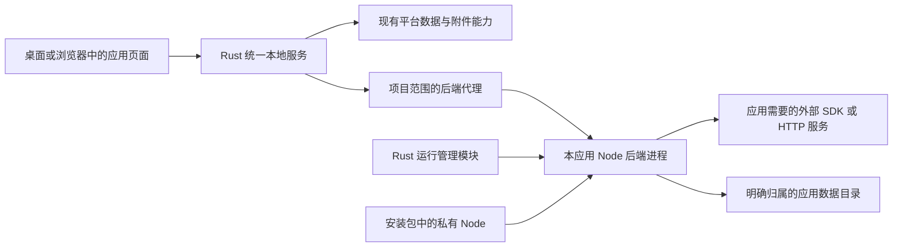

# 内置 Node 与应用后端管理方案

2026-10-20 最新确认的[应用窗口运行约束](app-window-runtime-contract.md)优先适用：应用在唯一原生窗口运行，打开时后台启动本应用 Node，关窗停止，重复打开只聚焦，禁止额外窗口／业务弹窗。下文浏览器入口、显式启停控件或候选流程按其历史／协议层含义理解；本机传输不等于让用户另开浏览器。当前接入边界见[本机配置与运行](node-native-configuration.md)，不扩展完整 project-v1 生命周期。

更新日期：2026-10-20

状态：用户已确认内置 Node、应用后端统一启停、环境变量可视化配置及作者说明；2026-10-20 进一步确认区分带/不带 Node 服务的两类项目，在清单中声明并在平台展示类型图标。用户随后授权开始尝试并允许修改 radio 源码，已从[隔离受管试验](node-runtime-trial-verification.md)推进至本机源码槽、配置与原生运行子集，现状见[本机配置与运行](node-native-configuration.md)。公开安装、完整数据生命周期仍未交付；本文后续设计不自动成为已实现能力。

最新[应用开发环境与交付要求](app-development-environment.md)优先适用：默认前端与平台 SQL，确需 Node 才增加后端，尽量单服务；外部软件与在线服务前提提前说明。内置 Node 不附 npm 或用户端构建／安装，作者准备好前端与后端运行文件。

配套：[应用启动规范草案](node-app-startup-spec.md)、[可视化配置与环境变量规范](node-app-configuration.md)、[NR0–NR7 实施步骤](node-app-implementation-plan.md)。此前[固定连接器讨论](bundled-node-and-connectors.md)保留为历史与探测证据，不再作为当前实施范围。

## 1 交付目标与当前状态

普通用户安装平台后，无需安装或配置 Node。用户从详情“打开应用”，平台在后台启动需要的 Node，并在唯一原生应用窗口运行；关窗停止，重复打开只聚焦。管理界面显示启动中、运行中、已停止或异常，配置和明确重启按实际实现提供；不要求用户先操作独立服务，也不弹终端或业务新窗口。纯前端类型同样使用原生应用窗口，但不启动自己的 Node 后端。

应用所需 AI 地址、API Key、模型等通过平台“配置”表单填写，中文名称、用途、获取步骤来自应用清单；用户无需编辑环境文件。声明与用户值分开管理，普通配置与秘密凭据分开保存，启动时仅注入目标应用的 Node 环境。保存不自动重启或发起可能计费的请求，具体生效与存储规则见配置草案。

平台负责通用运行管理，应用负责业务逻辑及依赖。例如应用可以在自己的后端调用网易云 SDK、HTTP AI 接口和 TTS；平台不必分别实现这些 SDK 的业务适配器。Claude Code 已不是这条路线的必选依赖。其他外部 CLI 不会因内置 Node 自动安装、认证或获得运行支持。

| 项目 | 当前实际能力 | 本路线目标 |
| --- | --- | --- |
| 平台核心 | Tauri + Rust 本地服务，project-v1 的 SQLite、附件与管理能力；另有独立 Node 源码槽 | 保持核心结构，按契约扩展新类型保护 |
| 应用运行 | 网页与 Node 同在“我的项目”，进入唯一原生窗口；Node 槽不冒充 project-v1 | 自包含程序与依赖、可分发的标准类型 |
| Node | Mac arm64 内部版固定私有 Node 24.22.0，只运行后端；project-v1 构建仍用系统 Node/npm | 分目标系统验收运行时，不自动增加 npm 构建能力 |
| 启停监控 | 打开时后台启动，健康监控，应用关窗／平台退出回收所属进程；真实范围见复验 | 补齐异常恢复及完整数据操作联动 |
| 应用配置 | 清单表单、本机私有文件保存 Key、修订快照注入；保存不启动 | 按新类型契约补齐归档、复制、迁移等规则 |
| 外部包安装 | 已读取实验 `local-app.json` 并登记本机源码；未实现完整安装；原 project-v1 有完整 ZIP 导入 | 结合 AP 保护基础增加 Node 类型，不冒用旧导入格式 |

当前 Node 槽依赖可信原源码及其已准备的运行依赖，登记／打开不自动构建或执行 npm。内部界面与运行入口已接通，未增加 project-v1 Node CLI、SQL 或完整归档能力。固定开发身份、数据根、既有项目和 Windows 运行门禁保持；未交付能力不由修改清单或调用旧接口获得。

### 1.1 两种项目运行类型

| 用户看到的类型 | 清单运行类型 | 运行差异 | 平台类型标识建议 |
| --- | --- | --- | --- |
| 网页项目 | `static-web` | 没有应用自己的 Node 服务，网页使用平台既有能力 | 网页窗口线框图标 + “网页项目” |
| Node 服务项目 | `node-service`（新类型草案） | 网页附带一个平台管理的 Node 后端，使用内置运行时和声明的配置 | 服务线框图标 + “Node 服务项目” |

用户确认的是两类运行形态及可见图标；具体图形和新清单字段按配套规范定稿。类型由校验后的清单及受管记录决定，不靠源码里的 `package.json`、安装了哪些依赖或当前有没有 Node 进程猜测。网页项目构建时使用 Node/npm 也仍是网页项目；它仍可使用平台数据库、联网及浏览器能力。

项目卡片、详情和安装检测预览显示平台固定的类型图标与中文文字，保留应用原有名称和用户自定义图标。类型标识与进程、健康、配置、维护状态分开：Node 服务停止或缺少配置时仍是 Node 服务项目；网页项目不显示“Node 已停止”。显示与无障碍规则见[项目概览](project-metadata-and-overview.md)，条件清单与兼容规则见[启动规范](node-app-startup-spec.md)。

运行类型与是否附带源码、开发型/安装型身份是不同维度，不组合成更多互斥的产品类型。旧合法 project v1 按原静态语义兼容识别，不自动改文件；未知、矛盾或不支持的新类型明确拒绝运行，不能默认显示为可用网页项目。

## 2 结构与职责

- **磁盘上的引擎共享。** Node 可执行程序随平台安装和更新，平台按绝对路径调用，不修改系统 PATH，不替换用户自己的 Node。
- **进程和状态按应用分开。** 建议同一工作区内每个应用最多一个后端实例，多个窗口和浏览器共用；不同应用不共享进程内会话和凭据。
- **应用程序留在工作区。** 后端产物和完整运行依赖属于应用，随应用备份；不会把每个用户应用打进平台安装包。
- **构建与运行分开。** 现有源码构建继续使用现有系统 Node/npm 规则。内置运行时不自动变成构建工具链，构建任务也不能作为后台常驻入口。
- **平台控制入口。** 页面通过平台的项目会话访问后端代理，平台检查应用身份、文档代次、维护状态及当前后端实例。后端端口和控制凭据不作为网页配置发布。

内置版和系统 Node 使用相同的执行原理；差别在版本来源、调用路径、升级和生命周期由谁管理。平台内置固定版本减少机器差异，但不能保证所有 Node 包兼容。

## 3 第一阶段建议支持的形态

用户已确认[首版兼容以 Radio 类应用为基线](app-development-environment.md#首版兼容基线radio-类应用)。本节的单入口方向据此收敛，公开格式和数据／安装保护仍按前置契约落实；这不意味着任意 npm 包、CLI 或源码构建已经支持。

先支持“一份静态前端 + 一个 Node HTTP 后端入口”。前端继续由平台服务，后端只提供应用 API；统一启动规范负责入口、就绪和停机。应用需要适配该规范，不能承诺现成项目零修改即可运行。

运行产物必须在交付前准备好，优先使用打包后的 JavaScript 或完整纯 JavaScript 依赖树。导入、恢复和启动时不执行 `npm install`、安装钩子或作者自定义 shell。直接运行 TypeScript、任意 Node 参数、后台自我重启、多服务编排、SSR、原生扩展和额外二进制暂列后续兼容项；未验证前拒绝相应类型。现有应用若依赖 Node 自带模块，也必须对指定版本与目标系统验证。

首批应用把能直接调用的 SDK 放入同一个后端，减少额外服务。radio-bob 的受管适配已合并 SDK、单入口和动态端口，配套原生代理、配置与独立数据目录见[实际接入](node-native-configuration.md)；原开发双服务入口继续保留，不作为平台标准启动。其 SQLite 使用指定 Node 自带模块，未要求现场编译第三方扩展；依赖中未使用的其他平台组件不因此获得执行兼容保证。标准自包含依赖仍须明确并独立验收，不接管原业务数据。

通用 Rust/Python 后端、Docker、任意系统命令、系统守护服务和应用市场隔离不随本路线一并开放。

## 4 启动、停止与运行状态

建议状态与项目原有 `ready / maintenance` 分开建模：

| 后端状态 | 含义 |
| --- | --- |
| `stopped` | 已确认本平台管理的该实例及受管后代已退出 |
| `starting` | 预检和启动中，尚未接通业务请求 |
| `running` | 当前实例进程存在，并通过本次就绪握手 |
| `stopping` | 已禁止新请求，正在排空与退出 |
| `failed` | 启动失败或异常退出，记录具体原因 |
| `reconciling` | 重启后核对残留实例，暂不允许重复启动或目录切换 |

健康状态另记 `unknown / healthy / unhealthy`。进程存在不等于能响应；本地能响应也不等于网易云、AI 或 TTS 上游正常。外部接口失败应作为应用业务错误报告。

**启动顺序：** 检查项目类型、平台/运行时兼容、产物完整性与维护门禁 → 核对必填配置并获取一致修订的普通值和秘密 → 建立本次实例和控制通道 → 将声明变量注入目标环境，使用私有 Node 启动固定入口 → 核对就绪身份并验证本地响应 → 开通代理。配置缺失不启动；启动失败关闭入口、回收已启动进程、保留受限诊断。

**停止顺序：** 关闭新启动和新业务入口 → 通知应用正常收尾 → 排空请求、提交或回滚事务、关闭文件及监听 → 等待退出并核对受管后代 → 标记停止。到期仍不退出时允许强制结束受管进程，并记录异常终止；这不能证明未提交数据已保存或快照可用。

首版建议以用户明确启动/打开应用触发运行，无系统开机自启；关一个页面不停止共享后端，明确停止或退出平台才停止。导入、复制、恢复、回收站恢复和维护结束不自动执行后端。首版不做自动无限重启，不自动重放结果未知的业务请求；具体超时、探测频率、并发和日志预算在 NR0 冻结。

运行时间、退出码、最近心跳、异常原因和有限日志优先提供。CPU/内存统计可后置，未实现硬资源约束前不能宣称已限制应用用量。

## 5 故障、子进程与平台退出

管理器持有真实子进程句柄，并记录平台实例、应用身份、本次运行 ID、启动时间和程序身份。停止针对这个实例，不能按 `node` 名称批量结束，也不能只相信上次保存的 PID。重复启动、重复停止、启动中停止和迟到的就绪消息均须可判定。

macOS 可评估进程组及受管启动器；Windows 需独立评估 Job Objects 等机制。应用不得自行 daemonize、脱离管理或另起自我重启器。现有构建器的进程组回收可提供经验，但不是已完成的跨系统常驻管理器。

正常退出平台要先停全部后端。平台被强制结束、崩溃或机器断电时，不能依赖正常退出回调或 Rust 析构；需实现并实测父进程失联处理与下次启动核对。旧实例是否仍在写入不明确时，拒绝重复启动、恢复、移动和删除数据目录。恢复进程管理不等于重试业务请求。

Node 缺失、损坏或版本不兼容应使相关后端明确失败；目标是平台管理和已有静态应用仍可用，须通过故障注入证明。独立进程能减少单个应用崩溃的直接影响，不能保证系统资源耗尽时其他功能完全不受影响。

## 6 数据、备份与维护必须一起设计

现有平台数据库由 Rust 管理。Node 不直接打开同一份平台 `main.sqlite`，也不因获得数据路径就获得平台管理令牌。两种后端数据模式在 NR0 作出明确选择，不能混用：

| 候选模式 | 需要补齐的契约 |
| --- | --- |
| 使用平台数据能力 | 新增项目范围的后端数据访问协议，复用平台 SQL/附件规则；当前没有可直接调用的新接口 |
| 应用自有数据树 | 在独立受管目录保存自己的数据库/文件；定义初始化、归档、校验、凭据、更新与异常恢复，不能冒充已有平台库 |

为了保留既有 Node 应用，可优先评估独立数据树，但这不是批准直接接管 radio-bob 的 `.data`。真实数据迁移仍须设计公开流程并保留原现场。涉及音乐登录 Cookie 等凭据时，先确定存储和归档规则，再开放真实账号。

Node 可绕过平台 API 直接写文件，因此仅冻结 Rust API 不足以保护快照。开放真实数据前必须完成以下联动：

| 操作 | 后端要求 |
| --- | --- |
| 备份、导出、复制 | 关闭入口、排空并确认停止后生成一致快照；仅原应用原先运行、配置修订与原运行快照一致、凭据绑定仍有效且门禁允许时恢复原服务。有待重启配置或无法复现同一快照则保持停止，由用户明确启动 |
| 进入维护 | 先阻止启动和写入、停后端，再生成基线；基线失败不允许修改 |
| 结束维护 | 保留原有机械检查和代次推进；成功后由用户明确启动 |
| 恢复、删除、回收站操作 | 确认实例和受管后代退出、句柄释放，才能切换或移动；失败保留现场 |
| 工作区迁移 | 全局阻止启动，停全部后端，按现有公开迁移流程切换；旧根不得残留写入 |
| 导入、恢复登记 | 校验不执行代码，不复用归档中的 PID、端口、令牌，不自动启动 |
| 程序/应用更新 | 先停机并保护程序与数据现场，再切换；不自动执行 npm 或未确认的数据迁移 |

自有 SQLite 必须定义干净关闭和异常终止后的恢复/一致性校验，保留需要的日志文件；不能复制正在写入的数据库就宣称完整。停止失败或无法证明停写时，管理操作中止；强制终止不能自动把数据标成一致。

**运行依赖必须备份。** 现有备份排除源码 `node_modules`，该规则不能被套用到 Node 运行产物。新增类型必须明确不可变的后端发布目录，包含入口、运行依赖、版本摘要与许可证，随完整归档保留；恢复不应依赖联网重装。空间清理不能把必需运行依赖当缓存删掉。运行日志、临时目录、PID 和短期凭据不进入分享包。

上述扩展需要新的项目/归档版本和不支持时的明确拒绝。现有静态项目备份、维护和恢复契约继续有效，不自动改写旧项目。

## 7 信任、网络与凭据

Node 是以本机用户权限运行的代码，不是沙箱。指定可写目录是应用契约，不是操作系统访问限制；网页 CSP 也不能限制 Node 联网或读取文件。首期定位为用户信任的应用，安装时说明本机执行能力，不宣称能安全运行任意不可信代码。

平台用最小必要环境启动，不继承完整用户环境，不传平台管理令牌。应用后端本地监听也需要本次实例认证；回环地址本身不能阻止其他网页或本机程序请求。

应用环境变量可视化维护及秘密凭据管理已纳入本路线，按[配置规范](node-app-configuration.md)明确中文用途、获取步骤、保存与目标进程注入；现有[凭据约定](project-capabilities-and-secrets.md)同步此新增范围。用户在受信管理页输入 Key，保存后只返回已设置状态，应用业务网页和 AI 交接不获得 Key；后端 Node 必须能读到注入的值，不能称为对应用隐藏密钥。

用户最新明确秘密保存在每应用本机槽的 `configuration/credentials/`，目录0700、文件0600，以当前用户文件权限保护明文，不使用 macOS Keychain，不读删旧系统条目；不写源码、`.env`、业务库、日志、分享包或 Git。当前独立源码槽的配置与注入见本机接入说明；未来完整归档／复制仍须保护秘密，通用网络代理及任意供应商业务适配不因此开放。

## 8 分发与兼容

从受维护 Node LTS 中选择并测试目标版本，平台锁定精确版本、来源、摘要和许可证，随平台版本更新。应用声明兼容主版本；不匹配时明确拒绝，不静默改用系统 Node。大版本升级先跑样本与数据保护回归，不能为兼容而自动改应用代码。

macOS 验证私有可执行文件的嵌套签名、公证、Finder 启动、离线与 arm64；Windows 在既有运行门禁和文件保护前提下分别验证 Windows 10/11 x64、无终端窗口、进程树和文件占用。各系统独立验收，不用 Mac 结果替代 Windows，也不由本方案直接开放 Windows 运行。

官方机制参考：[Tauri sidecar](https://v2.tauri.app/develop/sidecar/)、[Tokio 进程管理](https://docs.rs/tokio/latest/tokio/process/index.html)、[Windows Job Objects](https://learn.microsoft.com/en-us/windows/win32/procthread/job-objects)、[Node 发布政策](https://nodejs.org/en/about/previous-releases)。这些说明实现路径，不构成本平台已完成验证的证据。

## 9 本轮交付边界

2026-10-19 至 2026-10-20 先整理方案、启动、配置与两类项目规范，随后用户授权开始试验并允许修改 radio。实际实现和验证见[首次受管试验](node-runtime-trial-verification.md)；没有修改现行 Schema、SDK、锁文件、图标资产或既有平台项目，没有接管 radio 原始数据/凭据。公开入口、配置界面、归档联动和正式发行仍未完成，不改写先前文档检查记录。
