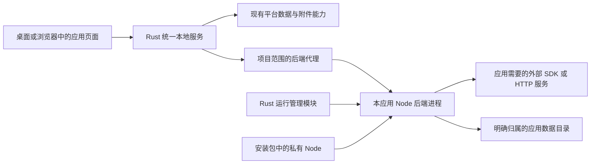

# 内置 Node 与应用后端管理方案

日期：2026-10-19

状态：用户已确认方向——平台内置 Node，运行应用自己的 Node 后端，统一管理启动、停止和运行状态；本轮只整理方案与规范，不写运行代码。本文的目录、协议、数据模式、默认策略和资源参数仍是设计草案，按 NR0 定稿后逐步实施。

配套：[应用启动规范草案](node-app-startup-spec.md)、[NR0–NR7 实施步骤](node-app-implementation-plan.md)。此前[固定连接器讨论](bundled-node-and-connectors.md)保留为历史与探测证据，不再作为当前实施范围。

## 1 交付目标与当前状态

普通用户安装平台后，无需安装或配置 Node。需要后台能力的应用，在详情中提供“启动、停止、重启、日志”，显示启动中、运行中、已停止或异常；运行引擎不弹终端窗口。纯前端应用继续沿用现有方式。

平台负责通用运行管理，应用负责业务逻辑及依赖。例如应用可以在自己的后端调用网易云 SDK、HTTP AI 接口和 TTS；平台不必分别实现这些 SDK 的业务适配器。Claude Code 已不是这条路线的必选依赖。其他外部 CLI 不会因内置 Node 自动安装、认证或获得运行支持。

| 项目 | 当前实际能力 | 本路线目标 |
| --- | --- | --- |
| 平台核心 | Tauri + Rust 统一本地服务、SQLite、附件与管理能力 | 保持核心结构，增加 Node 运行管理模块 |
| 应用运行 | 静态网页 + 平台 SDK | 增加有明确类型和版本的 Node 后端应用 |
| Node | 系统 Node/npm 用于源码构建 | 另带平台私有 Node，用于后端运行 |
| 启停监控 | 有构建任务的有限时进程管理 | 新增常驻后端状态、就绪、健康和停止管理 |
| 外部包安装 | `local-app.json` 尚未实现；已有完整项目 ZIP 导入 | 结合 AP 保护基础增加 Node 类型，不冒用旧导入格式 |

当前安装包没有携带此 Node，现有 SDK、CLI、HTTP、Schema 没有这些新能力。本方案不改变固定开发身份、数据根、既有项目或 Windows 运行门禁。

## 2 结构与职责

- **磁盘上的引擎共享。** Node 可执行程序随平台安装和更新，平台按绝对路径调用，不修改系统 PATH，不替换用户自己的 Node。
- **进程和状态按应用分开。** 建议同一工作区内每个应用最多一个后端实例，多个窗口和浏览器共用；不同应用不共享进程内会话和凭据。
- **应用程序留在工作区。** 后端产物和完整运行依赖属于应用，随应用备份；不会把每个用户应用打进平台安装包。
- **构建与运行分开。** 现有源码构建继续使用现有系统 Node/npm 规则。内置运行时不自动变成构建工具链，构建任务也不能作为后台常驻入口。
- **平台控制入口。** 页面通过平台的项目会话访问后端代理，平台检查应用身份、文档代次、维护状态及当前后端实例。后端端口和控制凭据不作为网页配置发布。

内置版和系统 Node 使用相同的执行原理；差别在版本来源、调用路径、升级和生命周期由谁管理。平台内置固定版本减少机器差异，但不能保证所有 Node 包兼容。

## 3 第一阶段建议支持的形态

先支持“一份静态前端 + 一个 Node HTTP 后端入口”。前端继续由平台服务，后端只提供应用 API；统一启动规范负责入口、就绪和停机。应用需要适配该规范，不能承诺现成项目零修改即可运行。

运行产物必须在交付前准备好，优先使用打包后的 JavaScript 或完整纯 JavaScript 依赖树。导入、恢复和启动时不执行 `npm install`、安装钩子或作者自定义 shell。直接运行 TypeScript、任意 Node 参数、后台自我重启、多服务编排、SSR、原生扩展和额外二进制暂列后续兼容项；未验证前拒绝相应类型。现有应用若依赖 Node 自带模块，也必须对指定版本与目标系统验证。

首批应用可把能直接调用的 SDK 放入同一个后端，减少额外服务。对 radio-bob，应在可丢弃副本验证网易云 SDK 的函数调用，并把固定端口、数据目录、前端根路径改为平台规范；不能沿用原有两个服务的启动脚本直接作为通用入口。其原始项目与数据保持不动。

通用 Rust/Python 后端、Docker、任意系统命令、系统守护服务和应用市场隔离不随本路线一并开放。

## 4 启动、停止与运行状态

建议状态与项目原有 `ready / maintenance` 分开建模：

| 后端状态 | 含义 |
| --- | --- |
| `stopped` | 已确认本平台管理的该实例及受管后代已退出 |
| `starting` | 预检和启动中，尚未接通业务请求 |
| `running` | 当前实例进程存在，并通过本次就绪握手 |
| `stopping` | 已禁止新请求，正在排空与退出 |
| `failed` | 启动失败或异常退出，记录具体原因 |
| `reconciling` | 重启后核对残留实例，暂不允许重复启动或目录切换 |

健康状态另记 `unknown / healthy / unhealthy`。进程存在不等于能响应；本地能响应也不等于网易云、AI 或 TTS 上游正常。外部接口失败应作为应用业务错误报告。

**启动顺序：** 检查项目类型、平台/运行时兼容、产物完整性与维护门禁 → 建立本次实例和控制通道 → 使用私有 Node 启动固定入口 → 核对就绪身份并验证本地响应 → 开通代理。启动失败关闭入口、回收已启动进程、保留受限诊断。

**停止顺序：** 关闭新启动和新业务入口 → 通知应用正常收尾 → 排空请求、提交或回滚事务、关闭文件及监听 → 等待退出并核对受管后代 → 标记停止。到期仍不退出时允许强制结束受管进程，并记录异常终止；这不能证明未提交数据已保存或快照可用。

首版建议以用户明确启动/打开应用触发运行，无系统开机自启；关一个页面不停止共享后端，明确停止或退出平台才停止。导入、复制、恢复、回收站恢复和维护结束不自动执行后端。首版不做自动无限重启，不自动重放结果未知的业务请求；具体超时、探测频率、并发和日志预算在 NR0 冻结。

运行时间、退出码、最近心跳、异常原因和有限日志优先提供。CPU/内存统计可后置，未实现硬资源约束前不能宣称已限制应用用量。

## 5 故障、子进程与平台退出

管理器持有真实子进程句柄，并记录平台实例、应用身份、本次运行 ID、启动时间和程序身份。停止针对这个实例，不能按 `node` 名称批量结束，也不能只相信上次保存的 PID。重复启动、重复停止、启动中停止和迟到的就绪消息均须可判定。

macOS 可评估进程组及受管启动器；Windows 需独立评估 Job Objects 等机制。应用不得自行 daemonize、脱离管理或另起自我重启器。现有构建器的进程组回收可提供经验，但不是已完成的跨系统常驻管理器。

正常退出平台要先停全部后端。平台被强制结束、崩溃或机器断电时，不能依赖正常退出回调或 Rust 析构；需实现并实测父进程失联处理与下次启动核对。旧实例是否仍在写入不明确时，拒绝重复启动、恢复、移动和删除数据目录。恢复进程管理不等于重试业务请求。

Node 缺失、损坏或版本不兼容应使相关后端明确失败；目标是平台管理和已有静态应用仍可用，须通过故障注入证明。独立进程能减少单个应用崩溃的直接影响，不能保证系统资源耗尽时其他功能完全不受影响。

## 6 数据、备份与维护必须一起设计

现有平台数据库由 Rust 管理。Node 不直接打开同一份平台 `main.sqlite`，也不因获得数据路径就获得平台管理令牌。两种后端数据模式在 NR0 作出明确选择，不能混用：

| 候选模式 | 需要补齐的契约 |
| --- | --- |
| 使用平台数据能力 | 新增项目范围的后端数据访问协议，复用平台 SQL/附件规则；当前没有可直接调用的新接口 |
| 应用自有数据树 | 在独立受管目录保存自己的数据库/文件；定义初始化、归档、校验、凭据、更新与异常恢复，不能冒充已有平台库 |

为了保留既有 Node 应用，可优先评估独立数据树，但这不是批准直接接管 radio-bob 的 `.data`。真实数据迁移仍须设计公开流程并保留原现场。涉及音乐登录 Cookie 等凭据时，先确定存储和归档规则，再开放真实账号。

Node 可绕过平台 API 直接写文件，因此仅冻结 Rust API 不足以保护快照。开放真实数据前必须完成以下联动：

| 操作 | 后端要求 |
| --- | --- |
| 备份、导出、复制 | 关闭入口、排空并确认停止后，生成一致快照；原应用原先运行且门禁仍允许时，才可在快照稳定后恢复原服务 |
| 进入维护 | 先阻止启动和写入、停后端，再生成基线；基线失败不允许修改 |
| 结束维护 | 保留原有机械检查和代次推进；成功后由用户明确启动 |
| 恢复、删除、回收站操作 | 确认实例和受管后代退出、句柄释放，才能切换或移动；失败保留现场 |
| 工作区迁移 | 全局阻止启动，停全部后端，按现有公开迁移流程切换；旧根不得残留写入 |
| 导入、恢复登记 | 校验不执行代码，不复用归档中的 PID、端口、令牌，不自动启动 |
| 程序/应用更新 | 先停机并保护程序与数据现场，再切换；不自动执行 npm 或未确认的数据迁移 |

自有 SQLite 必须定义干净关闭和异常终止后的恢复/一致性校验，保留需要的日志文件；不能复制正在写入的数据库就宣称完整。停止失败或无法证明停写时，管理操作中止；强制终止不能自动把数据标成一致。

**运行依赖必须备份。** 现有备份排除源码 `node_modules`，该规则不能被套用到 Node 运行产物。新增类型必须明确不可变的后端发布目录，包含入口、运行依赖、版本摘要与许可证，随完整归档保留；恢复不应依赖联网重装。空间清理不能把必需运行依赖当缓存删掉。运行日志、临时目录、PID 和短期凭据不进入分享包。

上述扩展需要新的项目/归档版本和不支持时的明确拒绝。现有静态项目备份、维护和恢复契约继续有效，不自动改写旧项目。

## 7 信任、网络与凭据

Node 是以本机用户权限运行的代码，不是沙箱。指定可写目录是应用契约，不是操作系统访问限制；网页 CSP 也不能限制 Node 联网或读取文件。首期定位为用户信任的应用，安装时说明本机执行能力，不宣称能安全运行任意不可信代码。

平台用最小必要环境启动，不继承完整用户环境，不传平台管理令牌。应用后端本地监听也需要本次实例认证；回环地址本身不能阻止其他网页或本机程序请求。

OpenAI 兼容 AI、TTS、音乐账号等配置由应用说明用途。秘密 key、音乐 Cookie 和控制令牌不得进入前端、公开清单、日志或分享包；哪些凭据可进入受保护备份、同机复制/恢复怎样重新绑定，须结合现有[凭据约定](project-capabilities-and-secrets.md)先定稿。Node 管理不等于平台已提供密钥存储、配置页或通用网络代理。

## 8 分发与兼容

从受维护 Node LTS 中选择并测试目标版本，平台锁定精确版本、来源、摘要和许可证，随平台版本更新。应用声明兼容主版本；不匹配时明确拒绝，不静默改用系统 Node。大版本升级先跑样本与数据保护回归，不能为兼容而自动改应用代码。

macOS 验证私有可执行文件的嵌套签名、公证、Finder 启动、离线与 arm64；Windows 在既有运行门禁和文件保护前提下分别验证 Windows 10/11 x64、无终端窗口、进程树和文件占用。各系统独立验收，不用 Mac 结果替代 Windows，也不由本方案直接开放 Windows 运行。

官方机制参考：[Tauri sidecar](https://v2.tauri.app/develop/sidecar/)、[Tokio 进程管理](https://docs.rs/tokio/latest/tokio/process/index.html)、[Windows Job Objects](https://learn.microsoft.com/en-us/windows/win32/procthread/job-objects)、[Node 发布政策](https://nodejs.org/en/about/previous-releases)。这些说明实现路径，不构成本平台已完成验证的证据。

## 9 本轮交付边界

本轮产出方案、启动规范和 20 个实施小步，现行文档同步新方向。未改运行代码、Schema、SDK、依赖锁文件或用户应用；未内置 Node、启动后端、读取账号数据或制作安装包。文档检查与独立复核的实际结果见[实施规划的本轮记录](node-app-implementation-plan.md#本轮文档记录)。
